  

 

<h2 align="center">⚓ 기술 스택</h2>

<table>
<tr>
<td align="center" width="140"><b>Language</b></td>
<td>

</td>
</tr>
<tr>
<td align="center" width="140"><b>Backend</b></td>
<td>

</td>
</tr>
<tr>
<td align="center" width="140"><b>Frontend · App · 3D</b></td>
<td>

</td>
</tr>
<tr>
<td align="center" width="140"><b>Database</b></td>
<td>

</td>
</tr>
<tr>
<td align="center" width="140"><b>Infra · Tools</b></td>
<td>

</td>
</tr>
</table>

 

  

<table>
<tr>
<td width="50%" valign="top">

**① [POPOL-ing](https://github.com/App-Legend/POPOL-ing)** · 포폴링 
내 프로젝트를 한곳에 모아 두고, 버튼 하나로 띄우고, 안 되면 왜 안 되는지 알려 주는 데스크톱 앱 
`Flutter` `Dart`

</td>
<td width="50%" valign="top">

**② [MgrS · Skills-GUI](https://github.com/App-Legend/Skills-GUI)** 
Claude Code · Codex 같은 AI 코딩 에이전트의 스킬을 한 화면에서 보고, 배포하고, 비교하는 데스크톱 앱 (AI 해커톤) 
`Flutter` `Dart`

</td>
</tr>
<tr>
<td width="50%" valign="top">

**③ [모아루틴 · habit_monster](https://github.com/dynamicduo-daelim/habit_monster)** 
습관을 체크하면 몬스터를 키우는 픽셀 게임형 습관 앱 (졸업 프로젝트) 
`Flutter` `Spring Boot` `Java 21` `PostgreSQL`

</td>
<td width="50%" valign="top">

**④ [Cleanroom Dashboard](https://github.com/gunoo-p/cleanroom-dashboard)** 
ESP32 센서로 반도체 클린룸 환경을 실시간 모니터링하고 이상을 예측하는 웹 대시보드 
`React` `TypeScript` `Three.js` `FastAPI` `TimescaleDB`

</td>
</tr>
</table>
